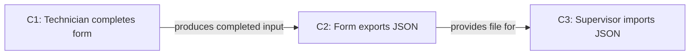

# File-based expository writing process

Use this process for substantive drafting and revision. Keep every stage inspectable and make the files needed by the next agent explicit. Read [purpose, reader and genre declarations](purpose-reader.md) before the first stage.

## Use the existing workspace

Use the document's current editorial or research workspace. Preserve its established paths, naming rules and source records. The names below illustrate roles; map them to existing files in a process index. Do not create a second parallel workflow merely to match this example.

Every executed stage saves its substantive result in a file. For a narrow edit, existing records can hold short named sections for the applicable stages. Record a genuinely inapplicable stage and its reason; do not claim a stage complete when it contains only a checklist or an instruction to do the work.

## Establish direction through an author interview

Before a new outline or a substantive change of direction, use [the author interview](author-interview.md). Review materials first; ask about the author's intended contribution and lessons, not facts the files already establish. Record one question and answer at a time, agreed terminology and writing decisions. Populate the declaration from confirmed answers. Do not treat a proposed interpretation as the author's position.

The author may explicitly skip the interview or authorise a provisional plan. Record that scope and unresolved assumptions. Continuing an agreed section or making a narrow edit does not require another whole-work interview. Later feedback updates the decision record and identifies affected downstream work.

## Readable intermediate records

Use meaningful headings, separate paragraphs, bullets, numbered steps and comparison tables in declarations, briefs, findings and repair records. Preserve IDs and exact source/version references inside that structure. A list of named fields must not render as one continuous paragraph. When reformatting a record that has already been read by another agent, retain its exact earlier bytes and link the formatting-only version change so historical read hashes stay interpretable.

## Process index and file contract

The index identifies the work, current author source, register, active versions, stage state, author decisions and next action. For each record, save:

- Stage and file path, with a section locator if a shared file is used.
- Version or content identifier, current/superseded status and state: proposed, ready for review, accepted or needs revision.
- Input files and the versions used, including exact source passages.
- Role responsible for the output and the role that must read it next. Record the actual agent identity and model only when the available run record establishes it; otherwise use unknown.
- The immutable instruction packet saved before dispatch, including named input versions and output ownership; separately recorded followups and their timing. Label recovered historical instructions by source and capture time.
- Actual files read by that role, and any missing or changed prerequisite.
- Decision or completed output, unresolved issue and dependency affected.

A receiving agent opens the index, the named prerequisite files and the actual source passages before working. It reads the contents, not only file names, hashes, another agent's summary or a prior verdict. A version identifier helps detect stale input; it does not replace reading. If an input changed, update the dependent record or identify what must be rechecked. Never overwrite author edits or claim an unseen editor buffer is preserved.

## Stages, outputs and required context

| Stage | Substantive file output | The next agent must open |
| --- | --- | --- |
| 0. Interview the author and establish direction | Source inventory, saved questions/answers, domain glossary where needed, writing decisions and confirmation or explicit skip/provisional instruction. | Current author answers, decision record, named materials and unresolved choices. |
| 1. Establish author, purpose, reader and genre | Work declaration: author position, purpose, audience, prior/needed knowledge, exclusions, genre constraints, scope and exact source text. | Declaration, its named author source and the source/decision record authorising the work. |
| 2. Inventory claims and support | Proposition register: claims, evidence, conditions and relationships. Record gaps outside the proposed prose. | Declaration, proposition register and the cited passages or data needed for the assigned section. |
| 3. Plan the narrative | Outline with section purpose, reader knowledge before/after, prerequisites, reasoning, definitions, examples and transitions. Required genre parts remain visible. | Declaration, claim register and narrative plan. |
| 4. Brief one section | Section brief: reader question, purpose and opening proposition; paragraph jobs; ordered claim/source IDs; exact author wording; exclusions; illustration; expected author-review state. | Current work declaration, register, narrative plan, section brief and selected source passages. |
| 4a. Edit visuals and tables | Visual/table briefs and actual editable artefacts/exports: reader question, intended relation, source/data, labels, caption, alt text, placement and review. | Declaration, section brief, proposition/narrative records, exact data/artefact sources and actual current visual/table files. |
| 4b. Edit appendices and reusable resources | Allocation record and selected supporting material: main explanation, appendix, shared data/code/skill/templates/process documentation, private evidence, exclusions and author/disclosure decisions. | Declaration, claim/section/visual records, actual selected resources, provenance and the authorised disclosure scope. |
| 5. Draft one section | Versioned section text plus a short record of inputs actually loaded and the claims/author wording used. | Same prerequisites as the writer, plus the exact draft version under review. |
| 6. Critique independently | A different agent's argument/fidelity findings and complete unit coverage with keep/delete/rewrite decisions. Record evidence for material findings. | Current draft, critic record, brief, declaration and actual sources needed to resolve findings. |
| 7. Repair and recheck | Revised section, repair response by finding ID and independent rereview of the changed text. Preserve the earlier version. | Revised text, findings, repair response, author source and any prerequisite affected by repairs. |
| 8. Obtain author decision | Accepted version or requested changes, protected wording, decisions and next action. | Author decision and the exact version it concerns; any updated declaration or brief. |
| 9. Assemble and hand over | Whole-work review: narrative/genre coherence, author fidelity, source links, derived summaries, current versions and outstanding decisions. | Settled sections, declarations, claim register, narrative plan, author decisions and final artefact. |

Visual/table and appendix/resource editing are roles with explicit files and ownership, not an instruction for a writer to improvise unseen supplements. Scale their work to the explanation; record a genuine no-artefact decision when an output is unnecessary. The independent critic checks these outputs and their coherence with the text. Detailed briefs and the requested inspector are in [editorial inspection and publication editors](editorial-inspection-report.md).

| Requested export | Substantive file output | The next agent must open |
| --- | --- | --- |
| Editorial inspection dossier | One self-contained HTML report plus editable source/build and a complete in-scope file manifest; stages, actual agent/model records, task packets/followups, input/read versions, outputs, critiques, repairs and author decisions. | The actual file manifest, stage index, generated records, instruction packets and disclosure scope. Preserve unknown and recovered-history states. |

The required review points follow the user's instructions. In a section-by-section workflow, show the outline before drafting and show each repaired section before progressing. Prior authorisation of specified changes remains valid; do not ask for the same permission again.

## Proposition register

Use propositions to expose what is being claimed. A useful starting form is **subject — predicate — object**. Preserve the original claim alongside that analysis. Do not force a complex argument into triples that lose its negation, modality, comparison, quantity, conditions or scope.

| Field | Content |
| --- | --- |
| ID and full claim | Stable claim identifier and the actual proposition in ordinary language. |
| Subject / predicate / object | Who or what the claim concerns; the relation or action; its object or complement. Use linked propositions when needed. |
| Conditions | Relevant time/version, audience, scope, negation, uncertainty or comparison already present in the source. Do not invent a condition to fill the field. |
| Authority and evidence | Author position, source statement, observation, instruction or inference; exact source locator and what supports the claim. |
| Relationships | Supports, depends on, defines, exemplifies, contrasts with or contradicts another claim. Explain an inferential link; a citation alone does not supply it. |
| Placement | Section and paragraph purpose served, or exclusion reason. |
| State | Ready, author decision needed, evidence gap or rejected; record the actual reason. |

The register is an analysis record, not prose to paste into the paper. Facts and the author's reasoning both need representation. If a claim is unsupported or conflicts with a source, describe the precise problem in the record. Do not silently dilute the author claim, add qualifications or claim it is verified.

## Narrative and knowledge scaffolding

For each planned section or paragraph group, write down:

1. What the reader knows on entry, including claims established earlier.
2. The question now being answered and the next proposition to establish.
3. Definitions, evidence, mechanisms or examples required to understand it.
4. How those elements support the proposition.
5. What the reader knows on exit and why the next part can follow.

Use this record to find unexplained terms, claims that rely on later explanations, unnecessary repetition and missing reasoning. The narrative can follow a procedure, a puzzle, an argument or a comparison. Chronology belongs when time or development explains the claim. An archive's order does not automatically determine the reader's order.

Respect genre constraints from the declaration. A required methods section still needs a reader-facing sequence within it. An essay's freer order still needs intelligible connections. Do not invent introductory scenes, stakes or conclusions to make the sequence feel complete.

## Optional concept map

Make a concept map when the proposition relationships are hard to inspect in the register. Use claim IDs and labelled edges; retain the register as the textual source. A plain Mermaid diagram is sufficient. Do not require a diagram for a clear short argument or infer scientific validity from a connected graph.

Distinguish dependency from support. The reader may need a definition before a claim without that definition constituting evidence for it. Mark competing or unresolved claims explicitly; do not draw a causal edge when the source establishes only association.

## Cohesion across boundaries

Use the [dedicated cohesion-review role](../../../writing/cohesion-review/SKILL.md) during independent criticism. Inspect every paragraph opening/end and section entry/exit against its actual context, alongside longer topic and referent chains. Record what prior entity or proposition is picked up, the real relationship and the knowledge added. Preserve clear genre/topic changes and conclusions; do not force a connective or forward teaser at every boundary.

Prefer a precise repeated term and enough explanation to make the connection apparent to this reader. Do not compress away a needed link or substitute an elegant synonym that obscures the referent. A connector or definite article supplies no evidence that its presumed antecedent or inference exists. Save the boundary review and proposed repairs before changing an authorised draft; rereview adjacent boundaries after repair. The independent critic can perform this specialist role, with separate named coverage, without adding a duplicate agent solely for administration.

## Writing, criticism and revision

The writer begins from the brief, not a blank whole-document prompt. Preserve specified author passages exactly. Supply the facts and reasoning needed by this reader; do not add generic reassurance, caveats or praise to fill a weak paragraph.

The independent critic uses [the Unslop critic procedure](../../../writing/unslop/references/independent-critic.md). It receives the author source, declaration, claim register, narrative plan, section brief and draft. Withhold the writer's self-assessment and other reviewers' verdicts. The critic checks argument and author fidelity before sentence patterns, then checks every sentence, paragraph, heading, table and caption. A claim of complete review requires a coverage record.

A writer's repair response identifies which findings were addressed and where. The critic reopens the revised file; the coordinator then reads the section against the author's source. A clean verdict is not a substitute for the coordinator's own reading. Record disagreements and unresolved factual concerns outside the draft; do not turn a critique into an unrequested rewrite of the author's position.

After assembly, reread the argument, genre structure and reader knowledge sequence. Summaries must reflect the settled body. A successful link check, word scan or export does not establish the quality of the explanation.

## Worked example: an equipment-inspection report

This example is fictional. Its complete source note says: “A technician completes the inspection form in a browser. The form exports a JSON file. A supervisor imports that file into the summary tool.” It supplies no evidence about time savings or inspection quality.

**Work declaration:** A short internal report explains the file exchange to a maintenance supervisor who already knows the inspection criteria but has not used the form. The reader needs to know what technicians send and how to load it. Hosting choices, software-development history and claims of efficiency are irrelevant. The report's commission requires an executive summary and permits a procedural body.

**Section declaration:** Explain how a completed inspection reaches the summary. The reader knows what an inspection is; they need the form, export and import sequence. The opening states that the supervisor imports the technician's exported file. Three paragraph jobs cover completion, export and import. A screenshot of the export control supplies the relevant illustration.

| ID | Subject | Predicate | Object | Evidence / relationship |
| --- | --- | --- | --- | --- |
| C1 | Technician | completes | inspection form in a browser | Source note, sentence 1. |
| C2 | Form | exports | completed inspection as JSON | Source note, sentence 2. Depends on C1's completed form. |
| C3 | Supervisor | imports | JSON file into summary tool | Source note, sentence 3. Depends on C2's exported file. |

**Narrative:** Start from the supervisor's task, identify the file they receive, then explain how it is created and imported. The exit knowledge is a usable file-exchange sequence. A claim that the process reduces errors would need evidence absent from this example and is excluded.

If readers confuse the export and import steps, this small optional map can expose the dependency:

**File handoff:** The writer opens the current purpose declaration, these claims, the narrative plan, the section brief and the source note. It saves a section draft. A different critic opens those same records and the draft, then records each unit's purpose and decision. If the writer added an unsupported efficiency claim, the critic flags it and the writer removes it within the agreed scope. The author decision identifies the accepted section version. The next agent opens that decision before continuing.

## Bounded checks and current versions

A basic checker can inspect declaration completeness, required paths, hashes, cross-file locators, claim coverage and handoff states. Save its findings and repairs. Such a check does not establish that source content supports the prose and does not replace the independent argument/author-fidelity critic. Invoke additional models only through the user's authorised workflow.

Freeze the draft version sent for critique and record its hash or equivalent version identity. The writer must not change that version while it is being reviewed. If inputs or text change, record the changed files, mark the earlier check stale and require the next agent to reopen the current contents before giving a verdict. Keep successive drafts and decisions separately identifiable.

## Check the connections in a practical explanation

For a procedure, choose a coherent reference implementation and verify the connections between its operations. An export existing in one version and an importer existing in another does not establish that the first feeds the second. Record the compatible source versions or the actual conversion step. In a proposition map, check the support for each relationship as well as each individual claim.

Keep historical variant differences in the evidence record unless explaining them serves the section's reader purpose. Do not repair a disjoint practical account by adding a catalogue of version qualifications. Revisit the source selection and explain the usable sequence.
